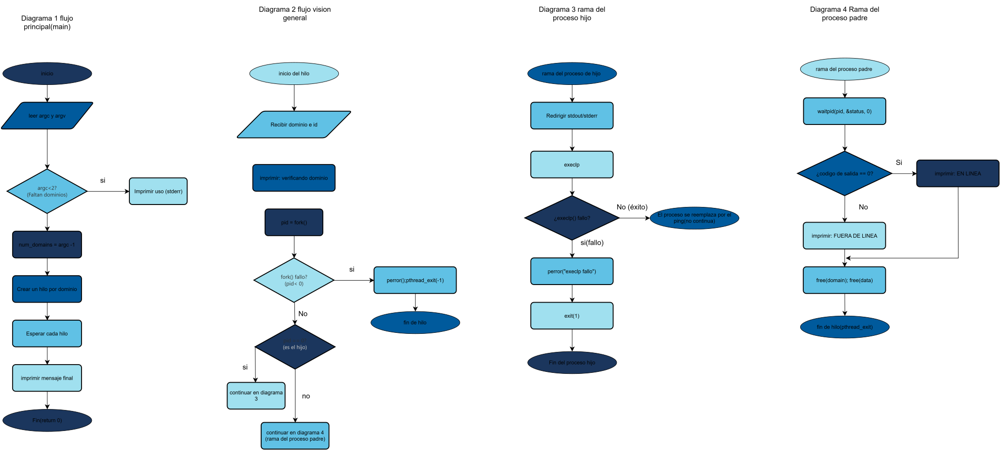

# Taller Práctico: Diagramas con draw.io — RPG Manager

**Asignatura:** Análisis de Sistemas  
**Proyecto:** RPG Manager  

---

## 1. Diagrama de Contexto (DFD Nivel 0)

### Ejercicio 1A — Flujos que faltan:
| # | Origen | Flujo de datos | Destino |
| :--- | :--- | :--- | :--- |
| **F10** | Jugador | `credenciales de acceso` | RPG Manager |
| **F11** | Servicio de Respaldo en la Nube | `datos de partida restaurada` | RPG Manager |

### Bug a corregir (Bloque 1):
- **Error 1:** La `"Base de datos de Personajes"` no debe aparecer en el nivel 0 (los almacenes de datos son internos y aparecen desde el DFD nivel 1).
- **Error 2:** `"Crear Personaje"` es un verbo/acción (caso de uso); los flujos de datos deben ser sustantivos (`datos del personaje`).
- **Error 3:** Dos entidades externas (`Jugador` y `Game Master`) no pueden conectarse directamente entre sí sin pasar por el sistema (`0 RPG Manager`).

---

## 2. Diagrama de Casos de Uso

### Ejercicio 2A — Generalización de actores:
- **¿Hacia dónde apunta el triángulo vacío y por qué?** Apunta hacia el actor general **Jugador**, indicando que `Jugador Premium` hereda todas las capacidades de `Jugador`.
- **¿Por qué el Jugador Premium NO necesita líneas a CU-01 ... CU-10?** Porque ya las hereda mediante la relación de generalización y solo requiere asociarse a su caso exclusivo (`CU-13 Comprar ítem exclusivo`).

### Bug a corregir (Bloque 2):
- **Error 1:** `"Inventario"` es un sustantivo; los casos de uso se nombran con Verbo + Sustantivo (`Gestionar Inventario`).
- **Error 2:** El actor `Game Master` debe estar fuera del límite del sistema (`RPG Manager`).
- **Error 3:** La flecha `<<include>>` debe salir del caso base (`CU-03 Crear Personaje`) hacia el caso incluido (`CU-04 Elegir clase`).
- **Error 4:** No deben existir asociaciones directas entre dos actores (`Jugador` y `Game Master`).

---

## 3. Diagramas de Actividades

### 3.1 CU-07 Combatir en la Arena

#### Ejercicio 3A — ¿Y si se acaban las pociones?:
- **Carril de la decisión:** `RPG Manager`
- **Guarda 1:** `[pociones > 0]` -> Va a la acción `"Restaurar vida del Personaje"`.
- **Guarda 2:** `[pociones == 0]` -> Va a la acción `"Informar 'Sin pociones disponibles'"` y regresa a la decisión de acción del `Jugador`.

### 3.2 CU-03 Crear Personaje (Ejercicio 3B)

- **¿Qué caso de uso del Bloque 2 aparece "escondido" dentro de este flujo?** Aparece el caso de uso **CU-04 Elegir clase (Guerrero, Mago, Arquero)**.

### Bug a corregir (Bloque 3):
- **Error 1:** La decisión `"¿Tiene flechas?"` solo tiene una salida (`[sí]`); toda decisión debe cubrir todos los casos (`[sí]` y `[no]`).
- **Error 2:** Un `fork` debe sincronizar sus caminos paralelos en un `join` antes de llegar al nodo final.
- **Error 3:** `"Calcular daño al oponente"` es responsabilidad del sistema, por lo que debe ubicarse en el carril `RPG Manager`, no en `Jugador`.